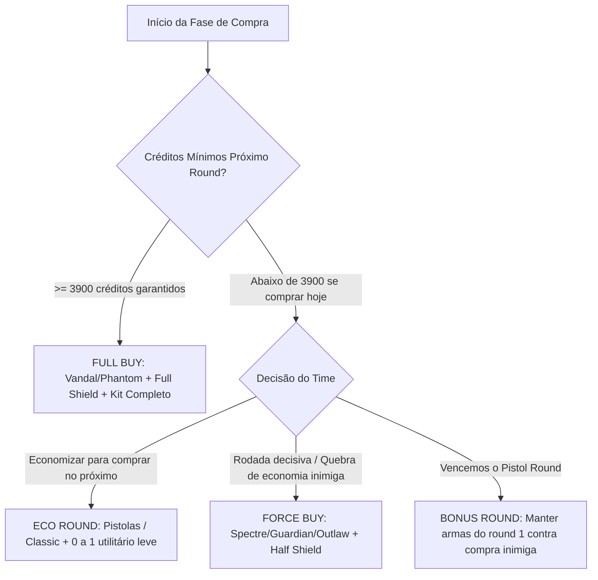

# VALORANT TACTICAL HUB | ESCOPO DE CONTEÚDO, ARQUITETURA E UX WRITING

> **Classificação do Documento:** Arquitetura de Informação, Guia Editorial de E-sports & Blueprint de Conteúdo  
> **Tom de Voz:** Analítico, Tático, Assertivo, Pro-Coach (Foco em Alta Performance e Competitivo VCT)  
> **Objetivo:** Portal de referência para macrogame, microgame, meta competitivo e lore do ecossistema de VALORANT.

---

## 1. ARQUITETURA E MAPA DO SITE (SITEMAP)

O portal foi desenhado sob uma hierarquia tática de três cliques máximos para qualquer conteúdo profundo, priorizando indexação técnica (SEO semântico) e usabilidade de alta densidade de dados.

```mermaid
graph TD
    Home["Home: Terminal Tático (Meta, Quick Guides & Ticker VCT)"]
    
    Home --> Lore["Universo (Lore & Arquivos Confidenciais)"]
    Home --> Agents["Agentes (Protocol Intelligence & Guias Pro)"]
    Home --> Maps["Mapas (Macrogame & Táticas de Rotação)"]
    Home --> Tools["Ferramentas & Análise Competitiva"]

    Lore --> LoreCrisis["A Grande Crise (Primeira Luz & Radianita)"]
    Lore --> LoreMirror["Guerra dos Mundos (Terra Alpha vs Ômega)"]
    Lore --> LoreRoster["Arquivo de Pessoal (Fichas Biográficas)"]

    Agents --> Duelists["Duelistas (First Blood & Espaço)"]
    Agents --> Initiators["Iniciadores (Info & Re-clearing)"]
    Agents --> Controllers["Controladores (Visão & Tempo de Spike)"]
    Agents --> Sentinels["Sentinelas (Ancoragem & Flank Deny)"]

    Maps --> ActivePool["Map Pool Competitivo Ativo"]
    Maps --> Callouts["Mapas Interativos & Callouts Oficiais"]
    Maps --> Playbooks["Playbooks de Default e Retake"]

    Tools --> MetaReport["Meta Report VCT (Pick & Win Rates)"]
    Tools --> EcoGuide["Calculadora & Manual de Economia"]
    Tools --> Dictionary["Glossário Tático de E-sports"]
```



### Menu Principal (Main Navigation)
1. **Home / Dashboard**: Central de comando com o Ticker do Meta Atual (Tier List VCT em tempo real), atalhos de rotas críticas e últimas análises táticas.
2. **Universo (Lore)**: Enciclopédia canônica do Protocolo VALORANT, Primeira Luz, Corporação Reino e os desdobramentos da guerra interdimensional.
3. **Agentes (Protocol Roster)**: Matriz de agentes categorizados por classes táticas com guias aprofundados de microgame, combos e setups.
4. **Mapas (Táticas & Macro)**: Decomposições geométricas dos mapas ativos, defaults de ataque, gatilhos de rotação e playbooks de retake.
5. **Meta & Análise (Crossover)**: Dicionário tático unificado, Matriz de Economia de Créditos e Meta Report com telemetria do cenário profissional.

---

## 2. DETALHAMENTO DE CONTEÚDO POR SEÇÃO

---

### SEÇÃO A: Lore & História (Nível Enciclopédia Profissional)

#### 1. A Grande Crise: A Primeira Luz e o Nascimento dos Radiantes
Em um futuro próximo não datado com precisão, a Terra experimentou um evento cósmico-geológico cataclísmico batizado como **A Primeira Luz**. Durante esse fenômeno, anomalias luminescentes globais romperam a estratosfera, liberando uma nova substância translúcida com propriedades energéticas sem precedentes: a **Radianita**. 

A introdução da Radianita desestabilizou o equilíbrio geopolítico mundial:
* **Transformações Biológicas:** Indivíduos diretamente expostos às emanações da partícula sofreram mutações no genoma celular, manifestando habilidades sobre-humanas psíquicas, telecinéticas, térmicas e gravitacionais. Estes indivíduos foram codificados como **Radiantes**.
* **Ascensão Tecnológica:** A **Corporação Reino**, um conglomerado petroquímico e tecnológico multinacional, monopolizou rapidamente mais de 70% das reservas mundiais de Radianita, criando redes de energia autônomas e equipamentos bélicos avançados que tornaram obsoletos os exércitos convencionais.
* **Criação do Protocolo VALORANT:** Para evitar o colapso civilizatório e conter incidentes de segurança nacional envolvendo Radiantes rebeldes e contenções de Radianita, um grupo de operações secretas foi fundado sob a liderança do veterano militar norte-americano Liam Byrne (**Brimstone**) e da cientista britânica Dra. Sabine Callas (**Viper**). O codinome da força-tarefa: **Protocolo VALORANT**.

#### 2. Conflito de Mundos: Terra Alpha (Primeira) vs. Terra Ômega (Espelho)
A premissa central dos confrontos em VALORANT — e a razão técnica para agentes idênticos se enfrentarem em campo — fundamenta-se na **Colisão de Realidades**.

| Eixo Comparativo | Terra Alpha (Terra Primeira) | Terra Ômega (Terra Espelho) |
| :--- | :--- | :--- |
| **Situação Ambiental** | Planeta estável; Radianita utilizada para avanços pontuais e defesa. | Colapso biológico iminente; esgotamento crítico de reservas naturais. |
| **Comportamento Militar** | Postura de defesa da Spike e contenção de roubo de recursos. | Força expedicionária invasora que planta a **Spike** para teletransportar Radianita. |
| **Percepção Pública** | O Protocolo opera nas sombras; governos desconfiam de Radiantes. | A Legião VALORANT é celebrada publicamente como heróis salvadores do planeta. |

**Mecânica Tática da Spike:** Ao contrário de um explosivo convencional, a Spike é um extrator e conversor molecular de Radianita. Quando ativada em solo Alpha, a Spike liquefaz e comprime o solo rico em minério para teletransportá-lo através de fendas de dobra quântica diretamente para os reatores da Terra Ômega. O papel dos Defensores Alpha é o desarme sistemático antes da saturação do campo.

#### 3. Ficha Biográfica Automatizada (Modelo do Protocolo)

```yaml
AGENTE: Omen
IDENTIFICAÇÃO_CIVIL: Desconhecida (Registros fragmentados sugerem "John")
STATUS: Radiante Fantasmagórico
ORIGEM: Desconhecida / Apátrida
DESIGNATION_NUMBER: 03 (Membro Fundador do Protocolo VALORANT)
FUNÇÃO_OPERACIONAL: Controlador
```

* **Histórico de Recrutamento:** Encontrado após um catastrófico colapso de confinamento em uma instalação secreta da Corporação Reino. Omen foi fragmentado no plano subatômico e recomposto por pura energia de Radianita e tecido de sombras. Resgatado e estabilizado por Sabine Callas (Viper), ele permanece no Protocolo movido pela busca incessante por suas memórias pregressas e pela dívida de sangue com sua restauradora.
* **Relações de Protocolo & Diálogos no Campo:**
  * **Viper:** Vínculo pré-incidente. As falas indicam cumplicidade profunda e arrependimento mútuo (*"Sabine, você se lembra do que éramos antes das cinzas?"*).
  * **Sage:** Tensão ideológica severa. Omen condena a habilidade de Sage de reviver soldados, afirmando que ela manipula o ciclo natural das almas que ele mesmo habita (*"Sage, você puxa vidas do mesmo vazio onde eu me afogo"*).
  * **Iso:** Relação de respeito cauteloso; ambos lidam com o silêncio e o isolamento de assassinos de elite.

---

### SEÇÃO B: Guias Avançados de Agentes (Foco em Mecânica e Alto Rendimento)

#### Modelo 1: Omen (Controlador)

##### 1. Análise Técnica do Kit de Habilidades
| Tecla | Habilidade | Tipo | Custo (Créditos) | Cargas Máx. | Cooldown / Recarga |
| :---: | :--- | :--- | :---: | :---: | :---: |
| **C** | Passos Tenebrosos | Teleporte Curto | 100 | 2 | Não recarrega |
| **Q** | Paranoia | Debuff de Visão/Áudio | 300 | 1 | Não recarrega |
| **E** | Manto Sombrio | Cortina de Fumaça (Hollow) | Grátis | 1 ativa + 1 estocada (150) | 30 segundos por carga |
| **X** | Salto das Sombras | Teleporte Global | 7 Pontos de Ult | 1 uso | Instantâneo ao canalizar |

##### 2. Dicas de Pro-Play & Combos de Equipe
1. **Combo "The Flash Blindside" (Paranoia + Duelista):** Dispare a **Paranoia (Q)** através de paredes em ângulos de 90° (ex: Ligação A para Banheiro na Bind) sincronizado exatamente no momento em que seu Raze entra com Carga de Explosivos ou Jett com Tailwind. O inimigo atordoado não possui áudio nem visão periférica, tornando a troca 100% garantida.
2. **One-Way Smokes Dinâmicas:** Posicione o **Manto Sombrio (E)** repousando sobre batentes de portas ou saliências de caixas (como na Entrada B do Meio na Ascent). Ao criar uma smoke cuja base fica a 1,5m do chão, você verá os pés do adversário antes que ele consiga qualquer ângulo de visão contra sua cabeça.
3. **Teleporte de Re-posicionamento sob Som de Conflito:** Jamais utilize os **Passos Tenebrosos (C)** em silêncio absoluto se um adversário estiver a menos de 15 metros. Sincronize a ativação do teleporte no milissegundo em que houver tiros ou uma habilidade barulhenta (Granada de Raze ou Recon de Sova) para mascarar totalmente o áudio de saída.

##### 3. Erros Críticos de Elo Baixo
* **Smoke Profunda Incorreta (Criação de Cobertura para o Inimigo):** Posicionar a fumaça "para dentro" do chokepoint em vez de rente à saída da parede, permitindo que os atacantes saiam da fumaça já checando ângulos abertos sem ficarem expostos ao fogo cruzado.
* **Ultimate de Coleta de Informação Desperdiçada:** Utilizar o *Salto das Sombras* no início do round sem objetivo claro e cancelar imediatamente por pânico, sem obter confirmação precisa do número de defensores no bomb oposto.

##### 4. Janela de Atuação Competitiva
* **Classificação de Mapas:**
  * **Tier S:** Ascent, Haven, Lotus, Split.
  * **Tier A:** Sunset, Bind.
  * **Tier B:** Breeze (substituído por Viper devido às longas distâncias).
* **Melhores Sinergias de Composição:**
  * **Fade / Sova:** O debuff de Paranoia combinado a revelações de parede elimina checagens manuais arriscadas.
  * **Jett / Raze:** Fumaças de longa duração com interior oco que possibilitam jogadas de shotgun e agressão interior.

---

#### Modelo 2: Jett (Duelista)

##### 1. Análise Técnica do Kit de Habilidades
| Tecla | Habilidade | Tipo | Custo (Créditos) | Cargas Máx. | Cooldown / Recarga |
| :---: | :--- | :--- | :---: | :---: | :---: |
| **C** | Erupção das Brumas | Fumaça Instantânea | 200 | 2 | Não recarrega |
| **Q** | Corrente Ascendente | Impulso Vertical | 150 | 1 | Não recarrega |
| **E** | Brisa de Impulso (Dash) | Mobilidade / Entrada | Grátis | 1 | Recarrega com 2 Abates |
| **X** | Tormenta de Aço | Facas Letais de Precisão | 8 Pontos de Ult | 1 uso | Recarrega facas no abate (Tiro Primário) |

##### 2. Dicas de Pro-Play & Combos de Equipe
1. **Entry Smoke-Dash Padrão:** Jogue a **Erupção das Brumas (C)** no meio do bomb site e ative o **Brisa de Impulso (E)** diretamente para dentro dela. Isso quebra a mira da defesa (crosshair placement), forçando os adversários a virarem as costas para o chokepoint principal e abrindo espaço livre para seu time.
2. **Eco Round Saver com Tormenta de Aço:** A ultimate não possui imprecisão por movimento. Em rounds de economia fraca do time, não compre armas de fogo; acione o *Tormenta de Aço* em conjunto com a *Corrente Ascendente* para conseguir abates em salto contra rifles inimigos, roubando armas de valor alto sem gastar créditos da equipe.
3. **Agregação de Linha com Flash de Iniciador (Breach/Skye):** Espere o flash estourar antes de dar o dash. O erro primário é entrar antes do utilitário de suporte, tornando Jett o alvo fácil do jogador antiespam.

##### 3. Janela de Atuação Competitiva
* **Classificação de Mapas:** Tier S absoluto em Ascent, Breeze e Haven.
* **Sinergias Chave:** Breach (Estorvo e Flash abrem o caminho para dash seguro) e Sova (Recon marca alvos para eliminação instantânea).

---

### SEÇÃO C: Mapas, Rotações e Táticas (Foco em Macrogame)

---

#### Mapa em Destaque: ASCENT

```
               [ BASE DEFENSORA ]
              /        |         \
         [ B-Site ]    |     [ A-Site ]
            |      [ MEIO ]      |
         B-Main        |       A-Main
              \        |         /
               [ BASE ATACANTE ]
```

##### 1. Anatomia do Mapa & Pontos Críticos
* **Pátio do Meio (Mid Courtyard):** É o ponto gravitacional de Ascent. Quem domina o Meio dita o ritmo da partida. O controle do Meio corta a rotação dos defensores pela base e viabiliza ataques duplos (*splits*) tanto para o B (via Mercado) quanto para o A (via Catwalk/Árvore).
* **Chokepoints Principais:** A-Main e B-Main são corredores estreitos com portas de contenção mecânicas. Ambos são vulneráveis a spam de penetração de parede pesada (Odin/Ares em B-Main).

##### 2. Padrão de Rotação e Macrogame

###### A. Default de Ataque Padrão (1-3-1)
* **Objetivo:** Negar avanços de informação da defesa e punir operadores agressivos sem comprometer a equipe em um único corredor.
* **Distribuição Operacional:**
  * **1 Jogador no B-Main (Sentinela/Lurker):** Mantém a pressão auditiva silenciosa e previne o avanço rápido da defesa pela B-Main.
  * **3 Jogadores no Meio (Controlador + Iniciador + Duelista):** Quebram a parede de orbe/conexão, usam utilitário para fumar Top Mid e avançam para dominar a Praça.
  * **1 Jogador no A-Main (Duelista de apoio/Iniciador):** Checa o avanço do A-Lobby e coleta o orbe da ultimate.

###### B. Gatilhos de Rotação Imediata
* **Gatilho 1 (Consumo Massivo de Utilitários Defensivos):** Se a Killjoy inimiga gastou a Nanoenxame, o Alarmebot e o Omen gastou ambas as fumaças no B-Main nos primeiros 15 segundos de round, a rotação pelo Meio para o A é mandatória. O bomb B estará sem recursos de retardo, mas o tempo necessário para atravessar o mapa punirá a equipe que forçar o chokepoint esgotado.
* **Gatilho 2 (First Blood no Meio):** Um abate conquistado no Top Mid abre instantaneamente o split para a Árvore do A, inutilizando o jogador isolado dentro do A-Site.

###### C. Protocolo de Retake Eficiente (Defesa do Bomb A)
1. **Regra de Ouro:** Não tente o retake descompassado (*1 por 1*). O retake em Ascent A exige coordenação de duas frentes simultâneas: **Spawn Defensor** e **Porta da Árvore**.
2. **Sequência de Utilitários:**
   * O Controlador fuma a saída do A-Main para cortar o suporte dos atacantes recuados.
   * O Iniciador dispara um Recon/Dardo rastreador no teto do Gerador para forçar os atacantes plantados a saírem da cobertura.
   * Abre-se a porta mecânica da Árvore ao mesmo tempo em que a equipe do Spawn avança, gerando uma tenaz de fogo cruzado no jogador que estiver escondido em Hell ou Green Box.

---

## 3. ELEMENTOS ADICIONAIS DE DIFERENCIAÇÃO COMPETITIVA

---

### Dicionário Tático de Callouts & Gírias Profissionais

| Termo | Definição Operacional de E-sports | Aplicação Tática Prática |
| :--- | :--- | :--- |
| **Trade Kill** | Abater o adversário no milissegundo imediatamente posterior à morte do seu aliado. | "Mantenha o espaçamento de 3 metros para garantir o trade no avanço." |
| **Anti-Eco** | Round jogado contra um adversário com créditos insuficientes para compra de rifles. | Manter distâncias longas com rifles contra armas curtas (Classic/Shorty). |
| **Default** | Posicionamento padrão no mapa para coletar informação sem comprometer um bomb site. | "Vamos fazer default 1-3-1 para identificar a posição da Operadora." |
| **Flank** | Movimento de contorno pelas costas da rota inimiga para punir rotações desatentas. | Sentinelas posicionam armadilhas nas costas para anular o flanco. |
| **Lineup** | Posicionamento geométrico pré-calculado de habilidades de dano/revelação a longa distância. | Molotov da Viper jogada do meio da rua que cai perfeitamente sobre a Spike desarmada. |
| **Lurker** | Jogador que atua separado do time principal para cortar rotações e coletar ruído de movimentação. | Cortar o reforço da defesa que corre pelo spawn sem checar cantos. |
| **Crossfire** | Posição onde dois defensores miram o mesmo chokepoint de ângulos divergentes. | O invasor só consegue olhar para um defensor por vez, sendo abatido pelo outro. |
| **Jiggle Peek** | Movimento de strafe ultra-rápido para dentro e fora da cobertura apenas para obter informação visual. | Obter a posição de uma Mira de Operador sem expor a caixa de colisão da cabeça. |
| **Exit Frags** | Abates coletados sobre adversários que fogem da área de detonação da Spike. | Prejudicar a economia inimiga no round seguinte matando quem tentou salvar a arma. |

---

### Sistema e Manual de Gestão Econômica de Créditos

A economia em VALORANT dita as chances probabilísticas de vitória de cada round. O sistema opera na garantia de que **o round seguinte é sempre consequência direta dos créditos remanescentes**.



#### Tabela de Renda Fixa por Resultado de Round
* **Vitória:** +3.000 créditos
* **Derrota (Round 1 de derrota):** +1.900 créditos
* **Derrota (2 derrotas seguidas):** +2.400 créditos
* **Derrota (3+ derrotas seguidas - Teto de Loss Bonus):** +2.900 créditos
* **Abate Individual:** +200 créditos por kill
* **Plantar a Spike (Atacantes):** +300 créditos para todos os 5 jogadores

#### Os 4 Estados de Compra do Time

##### 1. Full Buy (Compra Completa)
* **Condição:** Todos os membros com saldo para Rifle Principal (Vandal/Phantom: 2.900) + Escudo Pesado (1.000) + Habilidades essenciais (~400 a 600) = **Total de ~4.300 a 4.500 créditos**.
* **Conduta:** Confronto armado pleno. Máxima exigência de trades e setups de retake completos.

##### 2. Eco Round (Economia Estrita)
* **Condição:** Quando a equipe não possui fundos para compra completa no round atual, mas precisa garantir no mínimo **3.900 créditos** na virada do round subsequente.
* **Conduta:** Utilização de pistolas gratuitas (Classic) ou investimentos marginais (Sheriff/Ghost pontuais apenas se o saldo pós-compra permitir os 3.900). Proibido comprar rifles ou escudos pesados.

##### 3. Force Buy (Compra Forçada)
* **Condição:** Toda a equipe investe a totalidade dos seus créditos restantes em armas intermediárias (Spectre, Bulldog, Outlaw) e escudos leves, sacrificando a capacidade de compra do round seguinte em caso de derrota.
* **Gatilhos Estratégicos:**
  * Último round da metade (Round 12 ou Round 24).
  * Quebra de economia adversária: O inimigo acabou de perder 3 jogadores em um round que venceram e estão com economia fragilizada.

##### 4. Bonus Round (Round Bônus)
* **Condição:** Ocorre exclusivamente no **Round 3**, após a equipe vencer o Pistol (Round 1) e converter o Anti-Eco (Round 2).
* **Conduta:** Os jogadores mantêm as armas compradas no round 2 (Spectres, Bulldogs, Ares) e enfrentam o primeiro Full Buy dos adversários. O objetivo primordial não é necessariamente vencer, mas causar o maior dano econômico possível no inimigo (abater 2 ou 3 rifles) sem gastar nenhum crédito. Qualquer vitória no round bônus representa uma vantagem econômica desproporcional.

---

### Meta Report: Telemetria e Matriz de Escolha (VCT Champions / Pro Circuit)

| Agente | Classe | Pick Rate Global (%) | Win Rate Competitivo (%) | Status no Meta | Melhor Mapa (Tier S) | Tendência |
| :--- | :--- | :---: | :---: | :---: | :--- | :---: |
| **Omen** | Controlador | 74.2% | 52.8% | Indispensável | Ascent / Lotus | ↗ Em Alta |
| **Jett** | Duelista | 68.5% | 51.4% | Pilar Estrutural | Breeze / Ascent | → Estável |
| **Killjoy** | Sentinela | 61.1% | 53.2% | Âncora Absoluta | Haven / Ascent | → Estável |
| **Sova** | Iniciador | 58.7% | 50.9% | Dominante de Info | Ascent / Icebox | → Estável |
| **Viper** | Controlador | 54.3% | 54.1% | Dominante em Mapas Abertos | Breeze / Bind | ↘ Em Ajuste |
| **Cypher** | Sentinela | 51.9% | 52.3% | Anti-Flank Padrão | Sunset / Split | ↗ Em Alta |
| **Raze** | Duelista | 48.6% | 49.7% | Explosão de Espaço | Bind / Lotus | → Estável |
| **Fade** | Iniciador | 39.4% | 51.0% | Alternativa de Recon | Lotus / Sunset | ↗ Em Alta |
| **Breach** | Iniciador | 31.2% | 48.5% | Específico de Chokepoints | Fracture / Haven | → Estável |
| **Reyna** | Duelista | 3.1% | 44.2% | Fora do Meta VCT | N/A (Foco em SoloQ) | ↘ Inviável Pro |

---

## 4. DIRETRIZES FINAIS DE IMPLEMENTAÇÃO NO CMS / FRONTEND

1. **Taxonomia Semântica:** Todas as tabelas de habilidades e estatísticas contêm tags HTML com classes CSS identificadoras (ex: `.agent-stat-table`, `.meta-badge-tier-s`).
2. **Microdados Schema.org:** Implementação de `SportsTeam`, `FAQPage` e `HowTo` nos guias de retake e defaults para captura de Rich Snippets nas buscas do Google.
3. **Design System:** Estética "Tactical Command HUD", integrando a paleta clássica de VALORANT (Off-white `#ECE8E1`, Dark Navy/Slate `#0F1923`, Riot Red `#FF4655` e Ciano Radiante `#00F5D4`).
